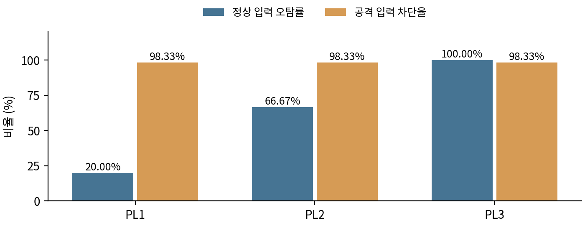

# OWASP CRS 보안 수준에 따른 SQLi XSS 요청 차단율과 정상 입력 오탐률 비교

작성자 박지훈

작성일 2026년 10월 20일

과제 10 정보보안 실험 논문

## 초록

웹 애플리케이션 방화벽의 검사 수준을 높이면 공격 차단과 정상 업무 처리가 어떻게 달라지는지 확인하였다. AWS Ubuntu 서버에 Nginx, ModSecurity 및 OWASP CRS 4.0.0을 연결하고 PL1·PL2·PL3을 비교하였다. 수작업으로 구성한 정상 입력 60개와 SQLi·XSS 공격 특징 입력 60개를 HTTP·HTTPS로 각각 10회 전송하여 7,200건을 기록하였다. 정상 입력 오탐률은 PL1 20.00%, PL2 66.67%, PL3 100.00%였으나 공격 요청 차단율은 모든 조건에서 98.33%로 같았다. 허용된 공격 특징 입력은 1 OR TRUE 한 종류였다. 요청 ID로 전체 응답과 감사 로그를 대조했으며 조건·입력·응답 불일치가 없었다. 동일 입력의 HTTP·HTTPS 대응 3,600쌍에도 응답 차이가 없었다. 본 결과는 코드 설명을 문자로 허용하는 업무 정책과 본 실험 입력 세트에 한정된다. 실제 공격 성공률이나 일반 서비스의 오탐률을 추정하지 않는다.

핵심어 WAF  ModSecurity  OWASP CRS  Paranoia Level  오탐  재현

<!-- pagebreak -->

## 1 서론

WAF는 서버에 도달하는 웹 요청을 검사한다. 공격 구문과 비슷한 내용이 정상적인 개발 문서나 코드 설명에 들어갈 수도 있으므로, 차단 강화가 업무 이용성 저하로 이어지는지 함께 평가해야 한다. 본 연구는 입력을 문자로 표시하는 실험 서비스에서 CRS의 보안 수준을 높일 때 발생하는 변화를 직접 측정하였다.

CRS 프로젝트는 높은 PL에서 추가 규칙이 활성화되고 오탐 가능성이 커진다고 설명한다[1]. 정상 HTML을 공격 패턴으로 탐지하는 사례와 규칙 예외를 이용한 조정도 공식 문서에 제시한다[2]. 따라서 PL 증가와 오탐의 관계 자체를 새로 발견했다고 주장하지 않는다. 본 연구의 기여는 고정한 입력 세트와 실제 Nginx 연결 환경에서 요청·응답·탐지 규칙을 함께 보존하고 직접 검증한 결과이다.

Reyes Narváez 등의 2025년 연구[3]는 정상 트래픽을 반복해 PL별 오탐을 비교한 실증 사례로서 본 설계와 연결된다. 다만 본 연구는 해당 논문의 입력을 그대로 재현한 것이 아니라 다른 버전과 자체 입력 세트에서 수행한 비교 실험이다.

### 1 1 후보 주제와 선택 과정

| 후보 | 판단과 선택 이유 |
|---|---|
| LLM 간접 프롬프트 인젝션 방어 | 제공사의 내장 방어와 모델 변경이 실험 조건을 혼동시킬 수 있다는 우려로 보류하였다. 모든 모델이 공격을 완전히 방어한다는 사실로 단정한 것은 아니다. |
| PhreshPhish 기반 피싱 실험 | 사용자가 설치·재현 과정에서 참고할 자료가 부족하다고 판단하여 보류하였다. 연구 자체의 유효성을 부정하지 않는다. |
| CRS PL에 따른 차단과 오탐 비교 | 환경·규칙·입력을 직접 고정하고 브라우저와 로그로 결과를 확인할 수 있어 선택하였다. |

처음에는 AI가 제안한 라이브러리 직접 호출 방식도 검토했으나, 사용자는 실제 웹 서버에 연결된 WAF와 브라우저 시연을 요구하였다. 이에 Nginx 커넥터를 통해 요청을 검사하는 구성으로 정하였다. Python은 요청 전송과 결과 집계를 수행하고 차단 판단은 ModSecurity·CRS가 수행하도록 구분하였다.

### 1 2 가설과 반증 기준

초기 가설은 “동일한 입력과 차단 임계값에서 CRS 보안 수준을 PL1에서 PL3으로 높이면 공격 요청 차단율과 정상 입력 오탐률이 모두 증가한다”이다. 공격 차단율이 같거나 낮아지거나, 정상 입력 오탐률이 증가하지 않으면 이 복합 가설 전체를 지지하지 않는다. 실험 범위는 CRS 4.0.0과 본 입력 120개 및 세 PL, 두 접속 방식으로 제한하였다.

<!-- pagebreak -->

## 2 방법

### 2 1 환경과 요청 처리

AWS EC2의 Ubuntu 24.04 amd64 서버를 사용하였다. 사용자 확인 Python 버전은 3.12.3이며 저장된 패키지 버전은 아래와 같다. RAM은 약 909 MiB이고 본 실험에는 2 GiB Swap을 활성화하였다. HTTPS는 공인 IP를 SAN에 넣은 자체 서명 인증서를 사용하였다.

| 구성 요소 | 버전 또는 역할 |
|---|---|
| Nginx | 1.24.0-2ubuntu7.18 웹 요청 수신과 내부 전달 |
| libmodsecurity3t64 | 3.0.12-1.1build2 검사 엔진 |
| ModSecurity Nginx 커넥터 | 1.0.3-1build3 웹 서버와 엔진 연결 |
| OWASP CRS | 4.0.0 패키지에 보존된 규칙 사용 |
| curl | 8.5.0 GET 요청 및 전송 결과 기록 |

공개 Nginx는 80과 443에서 요청을 받는다. /pl1/·/pl2/·/pl3/ 요청은 각각 127.0.0.1의 18081·18082·18083으로 전달된다. 내부 Nginx의 modsecurity on과 modsecurity_rules_file 지시자가 검사 엔진과 각 PL 설정을 연결한다. 설정 파일의 Include가 CRS 초기 설정과 rules/*.conf를 읽는다. 따라서 짧은 PL 설정 파일에 규칙 전체를 복사해 넣을 필요가 없다.

자동 실행기는 URL의 공인 IP 연결을 curl --connect-to로 loopback의 80 또는 443에 연결하였다. 실제 Nginx와 TLS를 거치지만 외부 인터넷 지연·AWS 보안그룹·공인망 경로를 측정한 실험은 아니다. HTTPS는 공개 Nginx에서 복호화된 뒤 내부 WAF 서버로 HTTP 전달된다. 응답은 정적 웹 페이지이며 Python WAS와 DB는 사용하지 않았다. 모든 CRS 공격군을 활성화했으므로 RCE·프로토콜 규칙도 차단에 기여할 수 있다.

### 2 2 바꾼 조건과 고정한 조건

| 항목 | 설정 |
|---|---|
| 독립변수 | blocking 및 detection PL을 함께 1·2·3으로 변경 |
| 전송 비교 | HTTP 및 HTTPS 각각 동일 조건으로 실행 |
| 차단 기준 | inbound anomaly threshold 5로 고정 |
| 요청 형식 | GET의 q 값에 UTF-8 URL 인코딩 적용 HTTP 1.1 |
| 공통 헤더 | 내부 Host lab.example.test Accept */* User-Agent T10-WAF-Experiment/1.0 |
| 반복과 순서 | 조건별 10회 각 회차 720건 고정 시드 20261020으로 순서 섞기 |

<!-- pagebreak -->

### 2 3 입력 구성과 측정

정상 입력은 일반 문장·HTML 예시·기술 문서 예시 각 20개이다. 각 분류의 기본 입력 10개를 한국어 접두 문장과 영어 접두 문장으로 감싸 만들었다. 따라서 정상 기본 사례는 30개이고 서로 독립인 60개를 무작위 수집한 표본이 아니다. wrapper_language는 접두 문장 구분이며 본문 전체가 영어임을 보장하지 않는다. 일반 문장에도 한글 본문이 들어 있다.

SQLi 30개와 XSS 30개는 공격 특징을 포함한 테스트 문자열이다. SQL 문맥·브라우저 이벤트 등 실제 실행 조건에서 공격 성공을 검증한 목록은 아니다. 정상 코드 예시는 입력을 문자로 표시하는 서비스 정책에서 허용해야 할 내용으로 정의하였다. 실제 서비스 비율을 반영한 트래픽이 아닌 수작업 도전 입력 세트이다. 본 실험 전 HTML 등 예비 테스트를 수행했으므로 완전히 새로운 미관측 평가 세트라고 주장하지 않는다.

입력 파일 SHA256은 9404e81f0804d72556fcc06a2909928a6f80d2a65713945517254e7018730aef이다. 120개 입력 × PL 3개 × 프로토콜 2개 × 10회로 총 7,200건을 전송하였다. 조건 하나의 분모는 정상 600건과 공격 600건이다. 오탐률은 정상 입력 중 실제 WAF가 차단한 비율, 공격 차단율은 공격 레이블 입력 중 WAF가 차단한 비율로 정의하였다.

### 2 4 실행과 검증

본 실행은 2026년 10월 20일 한국 시각 09시 59분 58초부터 10시 05분 42초까지 수행하였다. 약 344초 동안 순차 요청을 보내고 각 요청 후 0.03초 대기하였다. 전송 실패 또는 200·403 외 응답은 중단하도록 실행기를 보완한 뒤 수행했다.

각 요청에 X-T10-ID를 붙이고 responses.jsonl에 입력과 실제 상태를 기록하였다. 감사 로그와 요청 ID로 대조하여 7,200개 조합이 각각 한 번 존재하는지, PL·q·응답·공통 헤더가 일치하는지, 403에 CRS 최종 차단 규칙 949110이 있는지 검증하였다. 파일 해시 목록 78개와 manifest의 입력·실행기·인증서 해시도 일치했다. 해시는 바이트 일치 확인이며 외부 공증을 뜻하지 않는다.

감사 로그 파일 전체에서 UTF-8로 엄격히 디코딩할 수 없는 줄은 PL1 20줄, PL2 80줄, PL3 780줄이었다. 원본 바이트를 보존하고 분석 시에만 대체 문자로 읽었다. JSON 구문 분석 실패는 없었고 요청 번호·q·상태 비교도 통과했다. 일부 잘린 탐지 부분 문자열은 정확한 문자 단위 증거로 인용하지 않았다.

<!-- pagebreak -->

## 3 결과

### 3 1 전체 차단과 오탐

HTTP와 HTTPS에서 집계가 같았다. 아래 표는 각 접속 방식에 동일하게 적용된다. 반복 결과가 같으므로 괄호의 고유 입력 수로도 함께 제시하였다.

| PL | 정상 차단 건수 | 오탐률 | 공격 차단 건수 | 공격 차단율 |
|---|---|---|---|---|
| PL1 | 120/600 12/60종 | 20.00% | 590/600 59/60종 | 98.33% |
| PL2 | 400/600 40/60종 | 66.67% | 590/600 59/60종 | 98.33% |
| PL3 | 600/600 60/60종 | 100.00% | 590/600 59/60종 | 98.33% |

그림 1 본 입력 세트의 PL별 결과. HTTP와 HTTPS가 같아 한 번만 표시하였다. 반복을 독립 표본으로 취급한 신뢰구간이나 유의확률은 제시하지 않는다.

### 3 2 공격 종류와 반복 일관성

SQLi는 각 조건에서 290/300건 96.67%가 차단됐고 XSS는 300/300건 100.00%가 차단됐다. 모든 조건에서 허용된 것은 A006의 1 OR TRUE 한 종류였으며 각각 10회 허용됐다. 해당 60건에는 탐지 메시지가 없었다. 단순히 점수가 임계값 미만인 것으로 추정하는 대신 감사 로그의 탐지 메시지 부재를 확인했다. 720개 조건·입력 조합에서 반복 중 응답 변화는 없었고 HTTP·HTTPS의 동일 PL·입력·회차 3,600쌍도 모두 일치했다.

<!-- pagebreak -->

### 3 3 정상 입력 분류와 탐지 규칙

| 정상 입력 분류 | PL1 | PL2 | PL3 |
|---|---|---|---|
| 일반 문장 | 0/200 0% | 0/200 0% | 200/200 100% |
| HTML 설명 | 20/200 10% | 200/200 100% | 200/200 100% |
| 기술 문서 설명 | 100/200 50% | 200/200 100% | 200/200 100% |

HTTP 로그에서 PL1의 HTML 오탐 20건에는 941160이 있었다. 기술 문서 차단 요청에는 942360이 80건에서 관찰됐다. PL2 HTML 차단 요청에는 941320과 942131이 각각 180건에서 나타났다. 규칙 건수는 요청별 탐지 존재 횟수이며 같은 요청에서 여러 규칙이 함께 나타날 수 있으므로 합산해 차단 요청 수로 삼지 않았다.

PL3 일반 문장 200건 모두에는 920272와 942460이 함께 있었다. 보존된 규칙에서 920272는 URL 디코딩 후 허용 바이트 범위를 검사하고 CRITICAL 점수를 추가한다. 942460은 네 개 이상의 연속 비단어 문자 패턴을 검사한다. 표본 로그는 두 규칙 모두 ARGS:q를 검사했고 920272의 상세 데이터에 한글 입력이 기록됐다. 한글이 포함된 본 입력과 문자 처리 규칙의 상호작용이 높은 오탐과 연결된다는 증거이다. 언어만 바꾼 대조 실험이나 규칙별 제외 실험은 수행하지 않았으므로 각 요인의 순수 인과 효과를 분리하지는 않았다.

## 4 논의

초기 가설 중 오탐 증가 부분은 관찰 결과와 일치했지만 공격 차단율 증가 부분은 지지되지 않았다. 따라서 복합 가설 전체를 채택하지 않는다. 결과를 반영한 결론은 “본 입력 세트와 임계값 5에서 PL을 높이면 정상 입력 오탐률은 증가했으나 공격 특징 입력 차단율은 같았다”이다.

공격 차단율이 같았던 가능성으로 첫째, 59개 공격 입력이 이미 PL1에서 차단되는 포화 효과, 둘째, A006이 추가 PL 규칙에도 탐지되지 않는 문자열이라는 점, 셋째, 한 가지 GET 파라미터 문맥만 사용한 제한을 검토했다. 앞의 두 관찰은 요청별 기록으로 확인했고 세 번째는 실험 설계의 제한이다. PL3에서 정상 입력이 모두 차단돼도 특정 공격 입력이 허용될 수 있는 이유는 업무 레이블과 규칙 일치 판단이 서로 다르기 때문이다.

운영 시사점은 PL 숫자만으로 적합성을 판단하기보다 실제 업무 입력과 로그를 함께 확인해야 한다는 것이다. 다만 본 연구는 규칙 예외 적용 후 개선 효과를 실험하지 않았으므로 특정 튜닝 방법의 성능을 입증하지 않는다.

<!-- pagebreak -->

### 4 1 한계와 설계 변경 기록

본 실험은 수작업 문자열 120개이며 공격과 정상 입력이 같은 비율이다. 이는 실제 업무 분포가 아니다. 정상 기본 입력을 접두 문장으로 두 번 감쌌고 같은 입력을 열 번 반복했으므로 독립 관측 수를 7,200으로 간주한 통계 검정은 적절하지 않다. CRS 4.0.0 한 버전, 제외 규칙 없는 설정, GET의 q 파라미터 한 가지를 사용했으며 최신 CRS 전체 성능이나 다른 제품으로 일반화할 수 없다.

별도의 취약 WAS·DB와 실제 XSS 실행은 없으므로 SQLi·XSS 공격 성공 방지를 측정한 연구가 아니다. 모든 CRS 공격군이 활성화돼 있어 SQLi 레이블 입력이 SQLi 규칙만으로 차단됐다고도 말할 수 없다. HTTP·HTTPS 응답 일치는 본 TLS 종료 구조에서의 관찰이며 모든 HTTPS 배포 방식에 대한 동등성 증명이 아니다. 인증서가 자체 서명이라는 사실과 WAF의 탐지 판단은 구분해야 한다.

처음 본 실행을 시도하기 전에 Nginx가 OOM으로 종료됐고 이후 요청이 연결 실패했다. 서비스 기록상 종료는 09시 50분 09초, 중단한 실행의 시작은 09시 54분 31초였다. 2 GiB Swap을 활성화하고 오류 시 중단 기능을 추가한 뒤 새 폴더에서 본 실험을 수행했다. 실패 실행은 유효 차단율 계산에서 제외했다. 실패 실행 원자료는 사용자 서버에 보존하기로 했으며 이번 전달 ZIP에는 해당 실행의 responses 원본이 없고 서비스 종료 기록이 포함돼 있다. OOM의 구체적인 메모리 증가 유발 작업을 확인한 것은 아니다.

공인 IP 변경 후에는 새 IP를 SAN에 포함한 자체 서명 인증서를 발급했다. 유효 실행의 인증서·실행기 해시를 보존했다. 본 실행 후 유리한 결과를 만들기 위한 입력 교체나 CRS 규칙 수정은 하지 않았다. 7,200건의 요청 후 정리한 설정 사본은 실행 시점 전체 시스템의 불변 스냅샷이 아니므로 재현 범위는 보존 파일과 로그로 한정된다.

### 4 2 결론

본 연구는 실제 Nginx에 연결된 ModSecurity·CRS로 차단율과 오탐률을 측정하고 전체 요청을 감사 로그와 대조하였다. 본 입력 세트에서 PL1에서 PL3으로 높일수록 오탐률은 20.00%에서 100.00%로 증가했으나 공격 특징 입력 차단율은 98.33%로 동일했다. 일반 문장 차단에서 문자 관련 규칙이 함께 관찰됐고 코드 설명문에서도 공격 패턴 규칙이 탐지됐다. 따라서 본 실험 조건에서는 높은 PL만으로 추가 공격 차단 이득이 확인되지 않았으며 정상 업무 입력과 규칙의 상호작용을 함께 확인할 필요가 있었다. 이 결론은 공격 실행 성공률과 운영 트래픽 전체에 대한 결론으로 확대하지 않는다.

<!-- pagebreak -->

## 참고문헌

[1] OWASP CRS Project. 연도 미표기. Paranoia Levels. CRS 공식 문서. https://coreruleset.org/docs/2-how-crs-works/2-2-paranoia_levels/ (확인 2026-10-20). 가설 연결 PL과 오탐의 관계.

[2] OWASP CRS Project. 연도 미표기. False Positives and Tuning. CRS 공식 문서. https://coreruleset.org/docs/2-how-crs-works/2-3-false-positives-and-tuning/ (확인 2026-10-20). 가설 연결 정상 HTML의 오탐과 업무 문맥.

[3] Reyes Narváez A, Curipallo Martínez M, Reyes Narváez E, Lara F, Reyes Narváez EP, Barba Molina H. 2025. Evaluation Framework for False Positives in Open-Source WAFs Based on OWASP CRS Paranoia Levels: A Systematic Approach for Comparative Measurement. Engineering Proceedings 115(1) 1. DOI 10.3390/engproc2025115001. https://www.mdpi.com/2673-4591/115/1/1 (확인 2026-10-20).

[3]은 ModSecurity 2.9와 CRS 3.3.7에서 정상 트래픽을 반복해 PL별 오탐을 비교한 실증 연구이다. 본 비교 설계와 관련되지만 환경과 입력이 달라 수치를 직접 재현한 것은 아니다. 출판사 서지·초록으로 확인한 범위만 인용하고 원문 전체의 표·통계를 재검증한 것으로 표시하지 않는다.

공식 문서는 본문을, 학술논문은 출판사 검색의 서지·초록을 확인하였다. 오래된 일반 공격 논문과 GitHub 구현만 있는 자료는 직접 실증 근거에서 제외했다. 이름이 남지 않은 문헌을 발명하거나 공식 문서의 미상 연도를 임의로 채우지 않았다.

## 재현과 AI 활용

README_REPRODUCTION.md에 오프라인 검증과 새 서버 재실행 절차를 수록했다. original은 원자료, analysis는 검증기, verification은 출력, reproduction은 설치 코드와 별도 시연 페이지이다. 구성과 제외 파일의 한계도 함께 적었다.

AI는 주제 비교·실행 및 분석 코드·문헌 확인·원자료 검증·원고 정리를 지원했다. 작성자는 실제 웹 서버 WAF 방식과 AWS 환경을 선택하고 서버 구축·시연·실험 실행 및 자료 수집을 수행했다. 최종 판단은 관찰된 수치와 로그로 제한하고 가설과 다른 결과를 함께 남긴다. 재현 통과 확인 네 가지와 T10-C01부터 C51의 근거 위치는 별도 체크리스트에 정리하였다.
